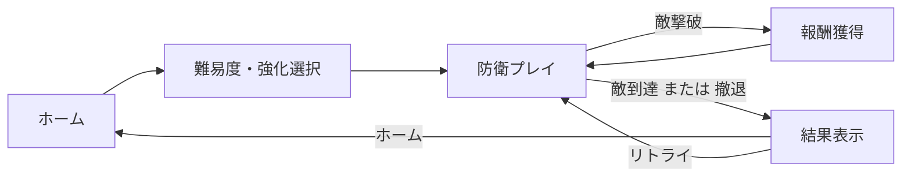

# SwordSlicer ゲーム概要

## 2. ゲーム概要

| タイトル | SwordSlicer |
| ジャンル | 2D防衛アクション／サバイバル |
| コンセプト | 剣をドラッグして回転・投擲し、ブーメラン状のカーブと攻撃間隔を操作して敵の波から防衛ラインを守る |
| 目的 | 敵が防衛ラインに到達するまで生き残り、撃破敵数・防衛時間・ヒット数などを伸ばす |
| ゲーム構造 | ホーム画面で難易度や強化を選択した後、防衛プレイに進行する。敵が防衛ラインに到達するか撤退すると結果画面へ遷移 |
| エンジン／言語 | Unity 6000.3.15f1 ／ C# |
| 描画・入力・UI | Universal Render Pipeline 2D、Input System、UI Toolkit。ワールド空間の一部表示（ダメージなど）には TextMesh Pro を使用 |
| 対応プラットフォーム | Android、Web Desktop Development。Build Profiles に設定済み |

## 3. 基本ゲームループ

ゲームフロー：

1. ホーム画面で難易度を選択し、必要に応じて通貨で強化を解放
2. ゲーム中は時間経過で敵の出現間隔・ステータスが増加し、敵種が順次解放される
3. ストックから剣を取り、ドラッグ操作で投擲する。敵撃破時に視覚・音響フィードバックと通貨が発生
4. 敵が防衛ラインに到達するか撤退すると結果画面へ遷移し、ホームへ戻るかリトライできる

## 4. 剣操作の仕組み

剣の操作方法：

- ドラッグの最後0.1秒間の位置変化から投擲方向を算出
- ドラッグ時間から投擲速度を決定
- ドラッグ中に蓄積した回転量を、投擲後の軌道カーブと攻撃間隔に反映
- 攻撃間隔は回転量が多いほど短くなり、最短0.01秒

詳細は [GameSpecification.md](GameSpecification.md) を参照。

## 5. 敵の特徴

各敵には異なる対処条件が実装されている。例えば：
- カエル：ジャンプアニメーション中は攻撃不可
- トロール：正面方向からの攻撃を防御
- ゾンビ：ダメージ後に無敵状態となり、移動が停止
- キノコ：胞子を生成して増殖

詳細は [GameSpecification.md](GameSpecification.md) を参照。

## 6. 参照資料

- [GameSpecification.md](GameSpecification.md)：ゲーム仕様（操作、敵、強化）
- [SystemArchitecture.md](SystemArchitecture.md)：システム構成
- [TechnicalDesign.md](TechnicalDesign.md)：実装設計
- [ImprovementPlan.md](ImprovementPlan.md)：既知の課題と改善案
