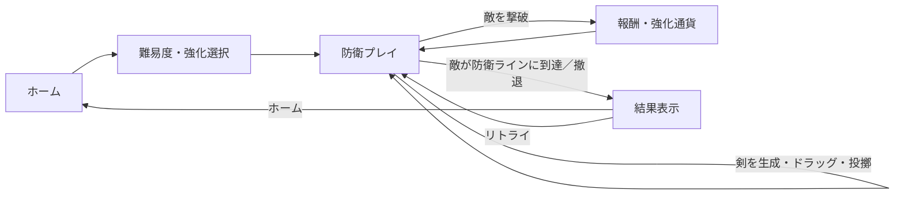

# SwordSlicer ゲーム概要

## 1. 資料の位置付け

本資料はUnityプロジェクト内のコード、Scene、設定、アセットを基にした実装解析版である。記述を以下のように区別する。

- **実装確認済み**：コードや設定ファイルで確認した事実。
- **設計意図の推定**：構造から合理的に読み取れる目的。開発者が明示した意図とは限らない。
- **未確認**：企画資料や動作検証がなく、断定できない事項。
- **改善提案**：現状実装を根拠にした将来案。

## 2. ゲーム概要

| 項目 | 内容 |
|---|---|
| タイトル | SwordSlicer（Player Settings の productName） |
| ジャンル | **実装からの分類**：2D防衛アクション／サバイバル。公式なジャンル表記は未確認。 |
| コンセプト | 剣をドラッグして回転・投擲し、ブーメラン状のカーブと攻撃間隔を操作して防衛ラインを守る。 |
| 目的 | 敵が防衛ラインに到達するまで生き残り、撃破報酬・防衛時間・ヒット数などを伸ばす。 |
| ゲーム構造 | `HomeScene`で難易度や強化を選び、`GameScene`で敵の波に対処する。敵がラインに到達するか、プレイヤーが撤退すると結果画面へ進む。 |
| エンジン／言語 | Unity `6000.3.15f1`／C# |
| 描画・入力・UI | URP 2D、Unity Input System、UI Toolkit。ワールド上のダメージ等の一部表示はTextMesh Pro uGUI。 |
| 対応候補 | AndroidとWeb Desktop DevelopmentのBuild Profileを確認。両プラットフォームでの実ビルド・実機動作は本資料作成時に未検証。 |

## 3. プレイヤー体験と基本ループ

**実装確認済み**：剣の近くを押してドラッグすると剣がポインターに追従する。ドラッグ中は防衛エリアに位置が制限され、回転量が蓄積する。離した方向へ剣が飛び、回転量と強化値に応じて軌道が曲がる。攻撃判定の周期は回転量で短縮される。剣は帰還せず、投擲から5秒経過すると破棄される。

1. ホームで難易度を選び、必要に応じて通貨で強化を解放する。
2. ゲーム中は時間経過で敵の出現間隔・ステータスが増加し、敵種も順次解放される。
3. ストックに自動追加される剣を取り、ドラッグ操作で投擲する。攻撃・撃破に応じて視覚／音響フィードバックと通貨が発生する。
4. 防衛ライン到達または撤退で結果を表示し、ホームへ戻るか同じSceneを再ロードする。

**未確認**：時間制限のあるクリア条件、プレイヤー体力、勝利状態、複数ステージ進行は確認できない。現状のコードは到達までの生存時間を競う構造である。

## 4. 特徴と差別化要素

- **実装確認済み**：単なる方向スワイプではなく、短時間のドラッグ位置サンプルから投擲方向を求め、周回操作で蓄積した回転量をカーブと攻撃頻度に再利用する。
- **実装確認済み**：ジャンプ中に攻撃できないカエル、正面を防ぐトロール、ダメージ後に無敵・停止するゾンビ、胞子で子を作るキノコなど、敵ごとに異なる対処を実装している。
- **実装確認済み**：強化の一部は解放済み範囲でレベルを上下でき、操作感を調整する。その他の強化はレベル上昇式。
- **評価**：この操作と敵の組み合わせは本作の特徴として説明できる。一方、他作品との比較調査は行っておらず、「市場で唯一」「競合にない」とは評価できない。

## 5. プレイヤー・制作規模・体制

- **推定**：ポインター操作を中心とするため、タッチ画面またはマウス入力に慣れたプレイヤーを想定しやすい。公式な年齢層・ターゲット層は未確認。
- **未確認**：開発人数、担当範囲、制作期間、商用リリース状態はREADME・設定・コードから確認できない。個人開発／チーム開発を断定しない。
- 本リポジトリにはC#スクリプト、2 Scene、敵・剣・UI Prefab、ScriptableObjectデータ、UI Toolkit、Animation、Audio、Sprite／Material等が含まれる。ローカルの `Library` や生成ビルド出力はソース設計資料の根拠としない。

## 6. 主要な参照先

- 既存説明：[README.md](../README.md)
- Scene：[HomeScene.unity](../Assets/Scenes/HomeScene.unity)、[GameScene.unity](../Assets/Scenes/GameScene.unity)
- 剣操作：[SwordControl.cs](../Assets/Scripts/Sword/SwordControl.cs)、[SwordAttack.cs](../Assets/Scripts/Sword/SwordAttack.cs)
- 敵進行：[EnemySpawnController.cs](../Assets/Scripts/Enemy/EnemySpawnController.cs)、[EnemySpawnScheduleSO.cs](../Assets/Scripts/ScriptableObject/EnemySpawnScheduleSO.cs)
- 技術的な注意事項：[TechnicalHighlights.md](TechnicalHighlights.md)、[ImprovementPlan.md](ImprovementPlan.md)
