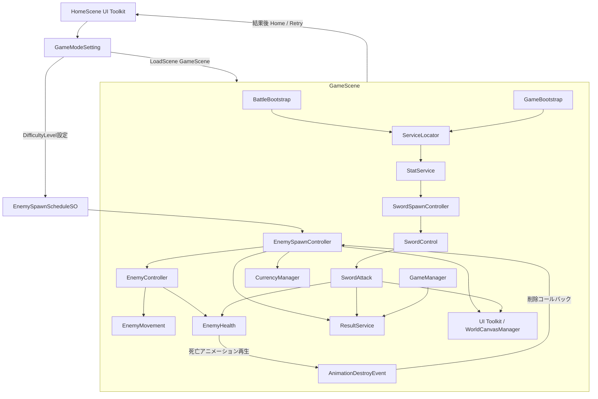
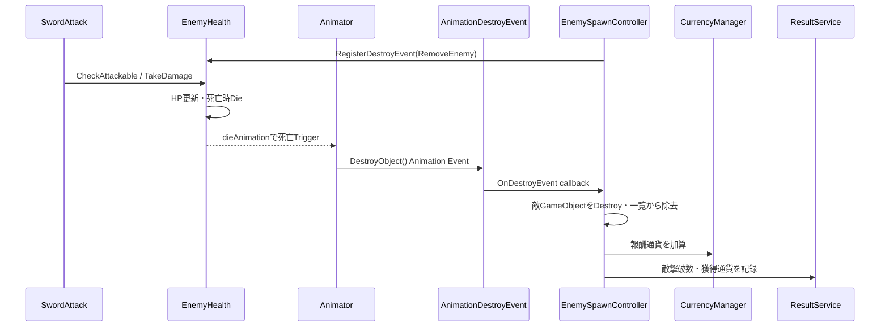
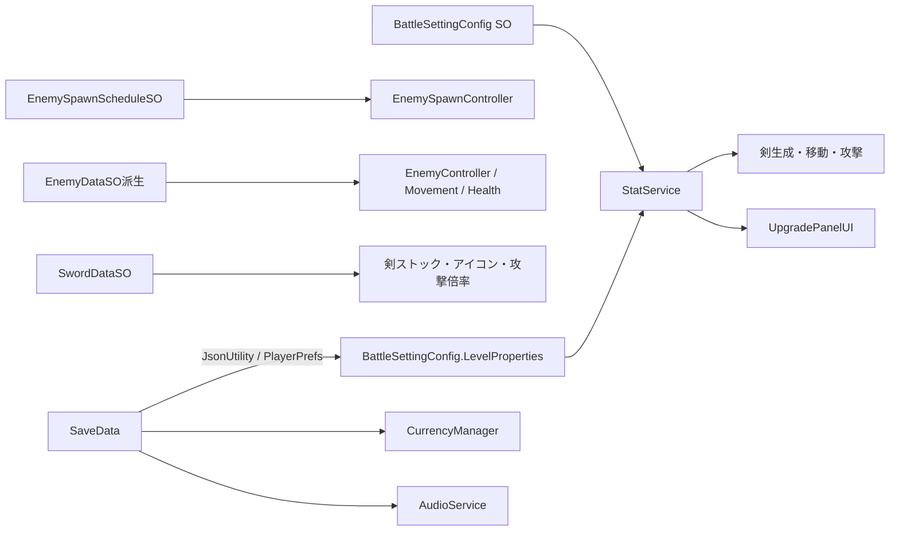

# SwordSlicer システム構成・アーキテクチャ

## 1. Scene構成

| Scene | 役割 |
|---|---|
| HomeScene | UI Toolkit パネル、ゲームモード・強化・保存ロード・音量・チュートリアル、GameBootstrap、SaveAndLoadService、音声管理。 |
| GameScene | BattleBootstrap、GameBootstrap、敵生成・剣生成・戦闘・統計・結果表示、UI Toolkit ゲーム中画面、URP 2D Light、Cinemachine。 |

Build Settings：HomeScene（index 0）、GameScene（index 1）。

## 2. システム構成図

## 3. 主要コンポーネントと責務

### 剣・戦闘

- **SwordSpawnController**：時間経過による剣データのストック追加、Prefab 生成、ISwordDraggingArea 実装。
- **SwordControl**：入力取得、ドラッグ処理、投擲方向・速度・回転量、曲線移動計算。
- **SwordAttack**：攻撃周期、Physics2D OverlapCircle 判定、ダメージ適用、命中フィードバック（効果音・揺れ・エフェクト）。

### 敵

- **EnemySpawnController**：スケジュールによる敵タイプ解放・抽選・出現制御、胞子・火の玉生成、撃破時の削除・報酬・結果加算。
- **EnemyController**：敵 Prefab データ接続、移動・体力・Animator 統合。ジェネリック型で型付きデータアクセス提供。
- **EnemyMovement**：共通進行度・位置・スケール・到達判定。仮想メソッドとフックで敵別挙動を実装。
- **EnemyHealth**：HP・被弾処理、死亡アニメーション、削除コールバック。ジェネリック型で型付きデータ提供。

### 進行・データ・UI

- **GameManager**：ゲーム停止・終了状態、PlayerPrefs プレイ済みフラグ管理。
- **StatService**：BattleSettingConfig と LevelProperty でダメージ・攻撃間隔・ストック上限・表示値を計算・提供。
- **CurrencyManager**：通貨値と変更イベント。
- **SaveAndLoadService**：JsonUtility と PlayerPrefs で強化・通貨・音量を保存・復元。
- **ResultService**：戦績蓄積、結果パネル表示、Unityroom スコア送信。
- **ShowPanelNavigationControllerBase / UIModuleBase**：UI Toolkit パネル表示スタック、共通モジュール初期化。

## 4. 初期化と依存関係

**GameBootstrap.Awake**：IAudioService、IStateService、ISave、ILoad をServiceLocator に登録。

**BattleBootstrap.Awake**：ISwordDraggingArea、IResultService、ICameraShake、敵生成・ゲーム停止・終了インターフェースを登録。

**利用パターン**：ServiceLocator.Get<T>() で取得。インターフェース型により具象クラス参照を隔離し、サービス置換を容易化。登録漏れは Get<T>() の例外で検出。

## 5. 敵撃破フロー

## 6. データフロー

設定値・敵／剣種別は ScriptableObject で管理。強化価格と LevelProperty 配列はコード定義。

## 7. イベントと状態管理

- **CurrencyManager.OnCurrencyChanged**：通貨 UI アニメーション更新。
- **EnemyHealth.OnHealthChanged**：ゾンビ無敵状態判定。
- **ZombieMovement.OnInvulnerableChanged**：ゾンビ Animator 更新。
- **GameManager.OnGameOver**：結果画面表示、スコア送信。
- **BattleSettingConfig.OnLoadLevelProperties、ILoad.OnLoad**：強化・音量 UI 更新。
- **GameManager.IsGameOver / IsGameStop**：static プロパティ。敵・剣・生成処理が参照。

一部イベントは OnDestroy で解除。GameManager.OnGameOver と UpgradePanelUI の static 購読は Scene 再ロード時に重複購読の可能性あり。

## 8. Prefab・ScriptableObject・開発支援ツール

- **Prefab**：剣、敵 10 種、攻撃・繁殖 Effect、ポップアップ（ダメージ・Miss・クリティカル・通貨）。
- **ScriptableObject**：EnemySpawnScheduleSO、BattleSettingConfig、敵データ SO、SwordDataSO、AudioDataSO、HowToPlayPanelModel。
- **Animation**：敵 Animator Controller・Clip、ポップアップ Controller・Clip。
- **開発支援**：ReadOnlyAttribute Editor PropertyDrawer、敵スポーン・剣操作・攻撃範囲の Gizmos。
