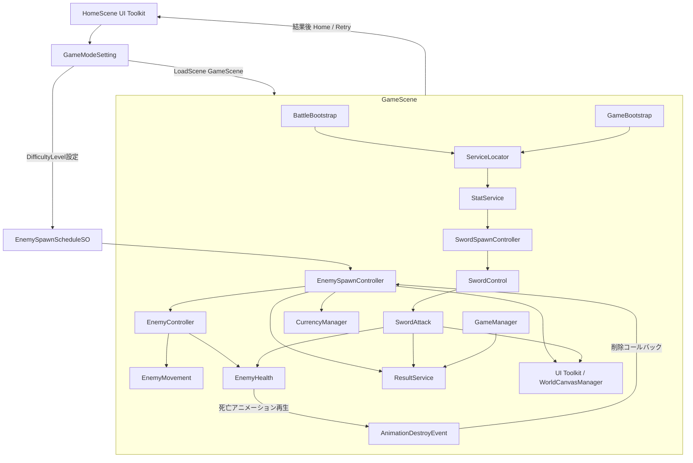
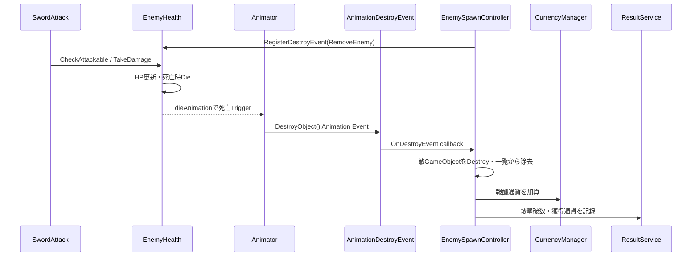
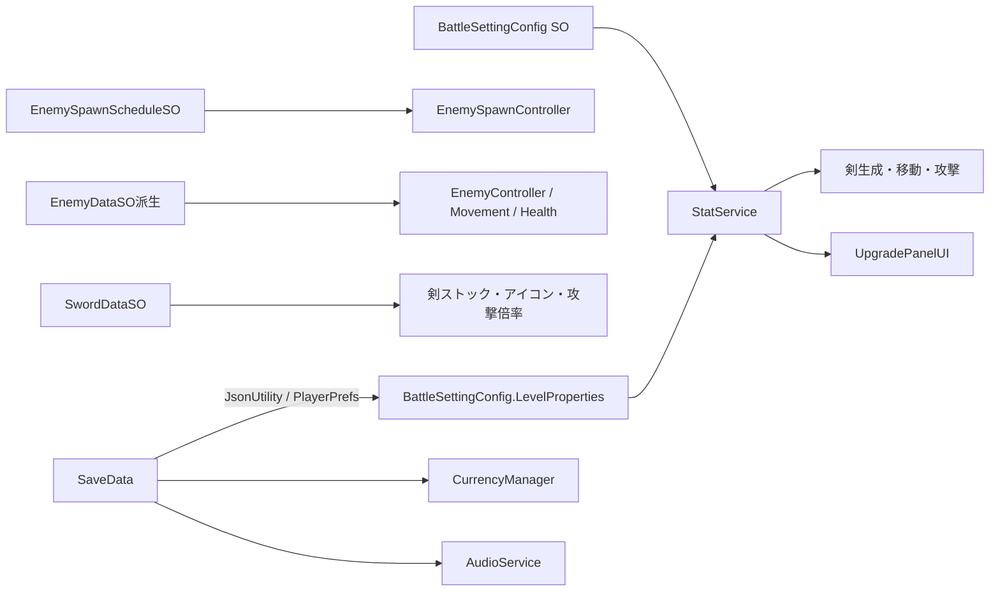

# SwordSlicer システム構成・アーキテクチャ

## 1. Scene構成

| Scene | 主な役割・確認済み要素 |
|---|---|
| `HomeScene` | ホームのUI Toolkitパネル、強化・難易度・保存／ロード・音量・遊び方、GameBootstrap、SaveAndLoadService、音声。 |
| `GameScene` | BattleBootstrap、GameBootstrap、EnemySpawnController、SwordSpawnController、StatService、GameManager、ResultService、WorldCanvasManager、ゲーム中UI、URP 2D Light、Cinemachine。 |

Build Settingsでは上記2Sceneが有効で、HomeSceneがindex 0、GameSceneがindex 1。各Sceneの完全なGameObject階層を図示するのではなく、スクリプトから追える主要連携を示す。

## 2. システム構成図

## 3. クラスと責務

### 戦闘・敵

- `SwordSpawnController`：時間経過で剣データをFIFOストックに追加し、現在の剣Prefabを生成。`ISwordDraggingArea`を実装。
- `SwordControl`：入力取得、ドラッグ、投擲方向・速度・回転量、曲線移動を管理。
- `SwordAttack`：攻撃周期、Physics2D範囲判定、ダメージ適用と命中フィードバック。
- `EnemySpawnController`：スケジュールによる敵タイプ解放、抽選・出現、胞子／火の玉生成、撃破処理を管理。
- `EnemyController`：敵Prefabのデータ・移動・体力・Animatorを接続。`EnemyController<TData>`が型付きデータ取得を提供。
- `EnemyMovement`：共通進行度・位置・スケール・到達判定。`EnemyMovement<TData>`とフックで挙動差を導入。
- `EnemyHealth`：HP・被弾・死亡アニメーション・削除コールバック。`EnemyHealth<TData>`が型付きデータを提供。

### 進行・データ・UI

- `GameManager`：ゲーム停止／終了状態とPlayerPrefsのプレイ済みフラグ。
- `StatService`：BattleSettingConfigとLevelPropertyを用いてダメージ・攻撃間隔・ストック・強化表示値を提供。
- `CurrencyManager`：通貨値と変更イベント。
- `SaveAndLoadService`：JsonUtilityとPlayerPrefsによる手動セーブ／ロード。
- `ResultService`：戦績の蓄積、結果パネル表示、Unityroomスコア送信。
- `ShowPanelNavigationControllerBase` / `UIModuleBase`：UI Toolkitのパネル表示スタックと共通モジュール初期化。

## 4. 初期化と依存関係

`GameBootstrap.Awake` は `IAudioService`、`IStateService`、`ISave`、`ILoad` を登録する。`BattleBootstrap.Awake` は `ISwordDraggingArea`、`IResultService`、`ICameraShake`、敵生成／ゲーム停止・終了インターフェースを登録する。利用側は `ServiceLocator.Get<T>()` で取得する。インターフェースは呼び出し側の具体クラス参照を一部隠すが、登録／取得は静的辞書に集約され、依存をコンストラクタ注入する設計ではない。

## 5. 敵撃破シーケンス

実際の削除タイミングはPrefabのAnimatorイベントに依存する。アニメーション終了イベントが発火することをScene上で実行検証したわけではない。

## 6. データフロー

設定値・敵／剣種別はScriptableObjectで管理される一方、強化価格とLevelProperty定義は現在のコードで静的に保持される。データ駆動性がシステム全体で一貫しているわけではない。

## 7. イベントと状態

- `CurrencyManager.OnCurrencyChanged`：通貨UIのアニメーション更新。
- `EnemyHealth.OnHealthChanged`：ゾンビの無敵閾値判定。
- `ZombieMovement.OnInvulnerableChanged`：ゾンビAnimator更新。
- `GameManager.OnGameOver`：結果画面表示など。
- `BattleSettingConfig.OnLoadLevelProperties`、`ILoad.OnLoad`：強化／音量UI更新。
- `GameManager.IsGameOver` / `IsGameStop` はstaticプロパティ。敵・剣・生成処理が参照する。

一部イベントはOnDestroyで解除される一方、`GameManager.OnGameOver` の匿名購読や `UpgradePanelUI` のstatic購読には対称な解除が確認できない。Scene再ロード時の重複購読を改善対象とする。

## 8. Prefab・データアセット・開発支援

- Prefab：剣、敵10種、攻撃／繁殖Effect、ダメージ／Miss／クリティカル／通貨UI。
- ScriptableObject：EnemySpawnScheduleSO、BattleSettingConfig、敵データ、SwordDataSO、AudioDataSO、HowToPlayPanelModel。
- Animation：敵Animator ControllerとAnimation Clip、ポップアップ用Controller/Clip。
- 開発支援：`ReadOnlyAttribute` のEditor限定PropertyDrawer、敵スポーン範囲・剣操作範囲・攻撃範囲のGizmosを確認。
- Assembly Definition、独立したEditor拡張群、テストコード、GitHub Actionsは確認できない。
